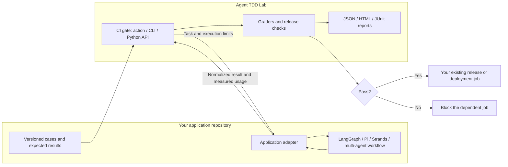
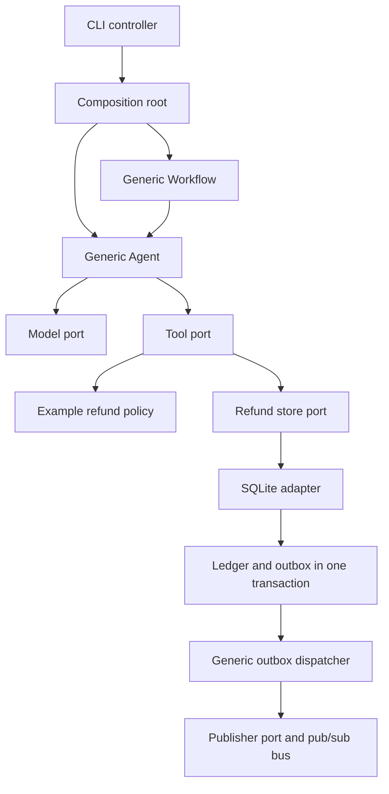

# Shared Agent Engineering Toolkit (Agent TDD Lab)

[](https://github.com/ZGTR/mshaker-shared-agent-toolkit/actions/workflows/ci.yml)

A reusable CI/CD quality gate for agents, harnesses, tools, and multi-agent workflows. Keep your existing **LangGraph, Pi (badlogic/pi-mono), AWS Strands, or custom runtime**. Call this repository from your pipeline to run cases, apply release gates, and collect JSON/HTML/JUnit reports. The included Python agent runtime is optional.

**Status:** production-oriented reference implementation with a tested local SQLite effect simulator. It does not send money, authenticate HTTP callers, guarantee model quality, or provide a distributed agent runtime. Read [production integration requirements](docs/production.md) before enabling external effects.

**Renamed:** this repository was `ZGTR/agent-tdd-lab`. It is the same repository, with the same history and MIT license. The Python distribution `agent-tdd-lab`, the `agent_tdd` imports and the `agent-tdd` CLI are unchanged. Git and web URLs redirect, but GitHub does not redirect Action references, so update `uses: ZGTR/agent-tdd-lab@…` to `uses: ZGTR/mshaker-shared-agent-toolkit@…`.

| Capability | What is here | Evidence level |
| --- | --- | --- |
| CI/CD release gates and reports | `agent-tdd evaluate`, composite `action.yml`, command protocol v1, JSON/HTML/JUnit reports | Implemented and tested in this repository |
| Evaluation engine and graders | Versioned cases, exact grader, baselines, request/token/cost gates | Implemented and tested in this repository |
| Reference agent runtime and workflows | `agent_tdd.harness`, `agent_tdd.workflow`, scripted/OpenAI/Bedrock adapters | Reference example; not a production runtime |
| Container and AWS deployment | `Dockerfile`, `infra/aws` | Reference example, validated offline; no live installation is claimed |
| External consumer adapters | Owned by each consuming application (first consumer: the private shared agent service) | Verified by that consumer, not by this repository |

## Use it in your application's CI/CD

**Yes: another repository can reference this repository as a GitHub Action, install its Python package, or invoke its CLI from any CI runner.** You provide application cases and a small adapter; you do not migrate your agent runtime.



The gate covers the cases and invocations your pipeline selects. Runtime enforcement, SDK retries, tool authorization and measurements belong at the actual application boundaries. Linking the repository does not automatically instrument every production agent call.

### GitHub Actions: reference this repository

Add these steps **after your normal application checkout, runtime setup and locked dependency installation**. The gate needs Python 3.11–3.13; Pi also needs the Node/Bun version and SDK dependencies your application uses.

```yaml
- uses: actions/setup-python@a26af69be951a213d495a4c3e4e4022e16d87065 # v5
  with:
    python-version: '3.12'
- name: Gate my existing agent system
  uses: ZGTR/mshaker-shared-agent-toolkit@v1.3.0 # Pin the reviewed release's full commit SHA in protected pipelines.
  with:
    cases: evals/agent.json
    executor-config: ci/agent.json
    report: artifacts/agent-gate.json
    repeats: '3'
    max-requests: '100'
    max-model-calls: '8'
    timeout: '30'
- uses: actions/upload-artifact@ea165f8d65b6e75b540449e92b4886f43607fa02 # v4
  if: always()
  with:
    name: agent-evaluation
    path: artifacts/agent-gate.*
```

`ci/agent.json` is a trusted file in **your repository**:

```json
{
  "command": ["node", "ci/pi-adapter.mjs"],
  "suite_kind": "live",
  "adapter_version": "my-pi-adapter-v1"
}
```

For Python, use `"command": ["python", "ci/agent_adapter.py"]`. Use `"scripted"` for offline/fake-model tests and `"live"` only for actual model runs. The adapter reads one JSON request from stdin and returns one normalized result/usage envelope on stdout. Pi's raw JSONL event stream needs normalization. [The integration guide](docs/ci-integration.md) defines the protocol and shows Python/Pi templates, framework seams, other CI providers and baseline comparisons.

A failed gate exits nonzero and fails the action step. **Make your release/deployment job depend on the gate job with `needs: agent-gate`**, and require the gate status in branch protection. Artifact upload does not enforce a release gate by itself. Keep credential-bearing model evaluations in trusted, protected jobs; run offline contracts on untrusted pull requests.

### Try the pipeline bridge offline

After cloning and installing below, run these without credentials, cloud resources or framework SDKs:

```bash
agent-tdd evaluate --cases evals/ci-echo.json \
  --executor-config examples/ci/python.json --report artifacts/python-gate.json
# Node.js is required for this second fixture.
agent-tdd evaluate --cases evals/ci-echo.json \
  --executor-config examples/ci/node.json --report artifacts/node-gate.json
```

These echo fixtures test the cross-process integration and reports. They do not run LangGraph, Pi, Strands, or measure model quality. Our [consumer-action CI job](.github/workflows/ci.yml) runs both fixtures through the public action and verifies that a deliberately wrong expectation fails its step.

### Choose the integration boundary

| Your system | How to connect it | What you keep |
| --- | --- | --- |
| LangGraph | Python `Executor`, or command adapter wrapping your compiled graph | Graph nodes, checkpointers, model callbacks and tools |
| Pi (`badlogic/pi-mono`) | Node/Bun adapter around your Pi SDK session; emit the normalized JSON envelope | Pi session, selected model, tool configuration and application policies |
| AWS Strands | Python `Executor`, or command adapter around your configured Strands agent/workflow | Strands model, tools, multi-agent orchestration and IAM configuration |
| Any other framework or language | Python `Executor` or a trusted executable implementing the command protocol | Your complete harness/runtime |
| Existing Python evaluation code | Import `evaluate(...)`, inject your `Executor` and `Grader` | Your orchestration and CI runner; no subprocess bridge is required |

The stock CLI uses exact code grading for structured outcomes and observed policy violations. Semantic tasks can inject a versioned Python `Grader`. An external adapter must account for every child-agent/model request, enforce the supplied allowance, and expose tool observations needed by your policies; the gate cannot see hidden framework activity.

## Clone and run

Python 3.11–3.13, Git, and a local writable filesystem are required. No AWS account, API key, Docker, or GPU is needed.

```bash
git clone https://github.com/ZGTR/mshaker-shared-agent-toolkit.git
cd mshaker-shared-agent-toolkit
python -m venv .venv
. .venv/bin/activate                 # Windows: .venv\Scripts\activate
python -m pip install --require-hashes -r requirements-dev.txt
python -m pip install --no-deps --no-build-isolation -e .
python -m pytest
agent-tdd workflow
agent-tdd refund --db demo.db --approve
agent-tdd refund --db demo.db --approve  # same receipt; no second effect/event
```

`agent-tdd refund --db blocked.db` exits **2** with `approval_required`. Successful examples exit **0**. Run `agent-tdd --help`. All amounts come from the local order table, never from model-provided arguments.

For reproducible development dependencies, install [uv](https://docs.astral.sh/uv/getting-started/installation/) and use `uv sync --frozen` followed by `uv run --frozen pytest`. `uv.lock` pins the complete dependency graph. The pip path is convenient; the frozen uv path is the reproducible CI path.

If migrating from the original single-file lab, do not keep an `agent_tdd.py` file inside the clone: that filename can shadow the installed `agent_tdd` package.

## Use your own agent

The core does not know about refunds. Models return `Decision` objects; tools implement a protocol; a composition root injects both. A task and output can be any supported JSON value. No base-class inheritance or framework is required.

```python
from agent_tdd.adapters.local import ScriptedModel
from agent_tdd.composition import context
from agent_tdd.harness import Agent
from agent_tdd.types import Decision

model = ScriptedModel([Decision("finish", output={"answer": 42})])
result = Agent(model, {}).run({"question": "example"}, context())
assert result.output == {"answer": 42}
```

For a tool, implement `execute(arguments, context, *, timeout_seconds) -> JsonValue` and register it under a stable name. See [adapter contracts](docs/adapters.md). To use LangGraph, Strands, CrewAI, PydanticAI, Bedrock, or a custom harness, implement the small `Model` or `Step` protocol. Those SDKs are not runtime dependencies of this repository.

## Agents, ordinary steps, and workflows

```python
from agent_tdd.workflow import Node, Workflow

# researcher and reviewer are any Step objects, including Agent or Workflow.
workflow = Workflow([
    Node("research", researcher),
    Node("review", reviewer, depends_on=("research",)),
])
result = workflow.run({"topic": "your task"}, trusted_context)
```

Each node receives `{"task": original_task, "upstream": {dependency: output}}`. Handoffs contain declared dependencies only. The same trusted context and atomic call budget are shared by every child agent. Cycles, duplicate names, missing dependencies, failed upstream steps, cancellation, and deadlines have explicit behavior. Execution is sequential in topological order: this is a small composable runner, not a parallel scheduler or durable workflow engine.

## Operational runner

```bash
agent-tdd run workflow --telemetry --result-mode metadata --timeout 30 --max-model-calls 20
agent-tdd run workflow --input-file task.json
```

The execution service constructs fresh agents per request, isolates input/output validators, reports metadata-only lifecycle events, and supports cooperative SIGTERM/SIGINT cancellation. Full result output can contain tool receipts; choose metadata mode for shared operational logs. See [extension architecture](docs/architecture.md).

## Versioned evaluations and release gates

```bash
uv run --frozen agent-tdd evaluate --cases evals/refund-routing.json \
  --provider scripted --report artifacts/smoke.json --repeats 3
```

This supplied command writes private JSON/HTML/JUnit reports and returns a failing exit code for failed gates. The same cases run through OpenAI-compatible endpoints or AWS Bedrock Converse; use `uv sync --frozen --extra bedrock` for the optional SDK. See [evaluation setup](docs/evaluation.md) for real provider configuration, baseline comparisons, generic executor/grader extension points, and main-only manual CI. Public routing fixtures and scripted passes demonstrate plumbing; they are not held-out quality evidence or permission to perform a refund.

## Containers and IaC

A pinned, non-root Docker image and offline Compose setup are included. The [AWS OpenTofu configuration](infra/aws) supplies an on-demand Fargate runner with separate IAM roles, digest-pinned images, a private network configuration, Step Functions execution deadlines/exit-code gates, and CloudWatch alarms. It uses an existing VPC and S3 state backend. Cloud resources are not applied by CI.

See [deployment and operations](docs/deployment.md) for tested local commands, provider-mocked IaC checks, prerequisites, image promotion, rollback, and recovery. The refund SQLite simulator stays local; deployable application effects require an appropriate remote durable adapter.

## Architecture and principles



| Principle | Concrete implementation |
| --- | --- |
| SRP | Domain contracts, controller, workflow, authorization, storage, event delivery, and JSON views have separate modules |
| DRY | One authorization policy, one ledger transaction, one generic agent loop; examples use the same core |
| IoC / DI | The composition root constructs adapters and injects protocol implementations; no service locator or global mutable container |
| MVC | Immutable result/decision models; Agent/CLI/workflow controllers; JSON views with no persistence logic |
| Pub/sub | Generic topic bus and durable outbox; subscriber failure cannot roll back an already committed effect |
| OOP / SOLID | Small cohesive objects and structural protocols; composition rather than inheritance-heavy framework coupling |
| Explicit boundaries | Trusted host context stays outside model-generated arguments; provider adapters normalize known errors |

There is deliberately no HTTP server, frontend, broker, plugin loader, or mandatory cloud platform. Add one when the application's requirements justify it.

## Test-first workflow

1. Describe a failure as an invariant, such as “missing approval creates no effect.”
2. Write a failing test through the real controller with a scripted model and isolated tools.
3. Implement the smallest change; run the affected tests.
4. Remove the guard temporarily and prove that the test fails, then restore it.
5. Run the full suite, lint, type checking, coverage, and packaging checks.
6. Run the supplied evaluation gate with your live provider and reviewed application cases. Offline tests establish harness behavior, not model intelligence.

```bash
ruff check .
ruff format --check .
mypy
pytest --cov --cov-report=term-missing --cov-report=xml
python -m build --no-isolation
python scripts/verify_mutation.py
```

Tests cover generic agents, custom tools, arbitrary JSON tasks, DAG handoffs, shared budgets, cancellation, malformed model output, approvals, tenant boundaries, crash/retry behavior, SQLite persistence, concurrent duplicates, and outbox replay. CI uses pinned actions and a Python matrix. No model calls are made by tests.

## Durable effects and events

The refund example uses an atomic SQLite transaction for a unique request key, at-most-one local refund per tenant/order, and an outbox event. Conflicting payloads are rejected. Fresh process/store instances see the same ledger. A lost response after commit can be retried with the original key.

Outbox dispatch is **at least once**. An event may be delivered again after a subscriber succeeds but acknowledgment fails, or when multiple dispatchers race. Consumers must deduplicate by event ID in their own transaction. The in-process bus is configured once at startup and is not a durable message broker. Don't put authorization, payments, or other critical writes in a best-effort observer.

## Documentation

- [Integrating your existing agent into CI/CD](docs/ci-integration.md)
- [Extension architecture](docs/architecture.md)
- [Deployment, IaC, and operations](docs/deployment.md)
- [Initial verification record](docs/validation.md)
- [Adapter contracts and extending any agent/framework](docs/adapters.md)
- [Production integration and operational limits](docs/production.md)
- [Tutorial: Reliable TDD for Agents](https://mohammadshaker.com/en/blog/reliable-agent-tdd-highest-roi)
- [Contributing](CONTRIBUTING.md), [security reporting](SECURITY.md), [MIT license](LICENSE)
