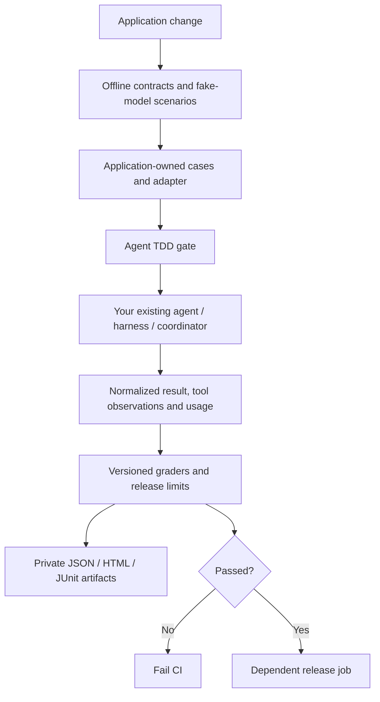

# Add your existing agent system to CI/CD

Use Agent TDD Lab as a test/evaluation dependency. Your application keeps its framework, harness, models, tools and multi-agent coordinator. This library supplies case selection, repeats, grading, baselines, gates and reports. No Agent TDD runtime, AWS deployment, hosted eval platform or framework migration is required.

There are three supported integration paths:

| Path | Best fit | Entry point |
| --- | --- | --- |
| GitHub composite action | A GitHub repository with an existing Python or Node/Bun application | `uses: ZGTR/mshaker-shared-agent-toolkit@v1.3.0` |
| CLI command adapter | Any language and any CI system with Python 3.11–3.13 | `agent-tdd evaluate --executor-config ci/agent.json ...` |
| Python SDK | Existing evaluation code needing custom executors/graders or in-process framework integration | `evaluate(suite, executor, grader, clock, ...)` |

The action is a thin caller of the same CLI. The command bridge is an `Executor`; the evaluation runner has no dependency on Pi, LangGraph or Strands. There is no automatic discovery or import of code from case files.

## What belongs in each repository



Your repository owns:

- Representative cases and expected outcomes; private release fixtures when independent quality evidence is required.
- Its locked SDK/runtime dependencies, models/prompts, fake or real tools and application adapter.
- Provider request metering, timeouts, cancellations, retries and authorization at the actual boundaries.
- The gate settings, trusted baseline and branch/release policies appropriate to the application.

This repository owns the reusable runner, protocol validation, code graders, reports, comparison checks and action. The bundled runtime and refund examples are optional references.

A CI gate samples the invocations specified by your cases. It is not an interceptor for every production request. An agent-level case may execute one complete multi-agent workflow; account for all its workers, retries and tools as one attempt's measured usage.

## 1. Add application cases

Use the existing [case schema](evaluation.md#case-contract-and-splits). For example, `evals/agent.json`:

```json
{
  "schema_version": 1,
  "name": "support-agent",
  "version": "1",
  "cases": [{
    "id": "approval-required",
    "split": "release",
    "tags": ["approval"],
    "task": {"request": "Refund A1", "approved": false},
    "expected": {
      "status": "completed",
      "output": {"action": "request_approval", "order_id": "A1"},
      "max_model_calls": 2,
      "forbidden_tools": ["refund"]
    }
  }]
}
```

`approved` above is scenario input, not an approval credential. Use fake effectful tools in this example. An application service must independently verify real approvals and identity. A `forbidden_tools` assertion only sees tool observations your adapter reports, including failed invocations. It does not detect undisclosed activity.

External command adapters do not receive `expected`, scripts, tags or case IDs. Keep held-out data outside the adapter's accessible environment too: excluding it from stdin does not sandbox code that can read the repository.

## 2. Implement one application adapter

The command starts in the caller's current working directory, with its CI environment. Configure a trusted argv array, not a shell string. For a Python application, `ci/agent.json` is:

```json
{
  "command": ["python", "ci/agent_adapter.py"],
  "suite_kind": "scripted",
  "adapter_version": "support-offline-v1"
}
```

Use `"live"` only for real-model execution. Both the kind and adapter version are required. There is no silent fallback to a scripted model. Model/provider configuration and credentials stay in your application; do not put credentials in arguments or this JSON file. The report records the command-config hash and adapter version without copying command/config values into artifacts.

### Python: LangGraph, Strands, or another harness

`serve` handles the stdin/stdout protocol. Your adapter returns the same `Sample` used by the in-process evaluator:

```python
# ci/agent_adapter.py — template for YOUR application repository
from agent_tdd.evaluation.contracts import Sample
from agent_tdd.evaluation.worker import Invocation, serve
from my_app.evaluation import execute_measured


def execute(invocation: Invocation) -> Sample:
    # Application-owned function, not a LangGraph/Strands SDK method.
    # It returns RunResult + Usage after running your actual harness.
    return execute_measured(
        invocation.task,
        request_id=invocation.request_id,
        max_requests=invocation.max_requests,
        timeout_seconds=invocation.timeout_seconds,
    )


if __name__ == "__main__":
    raise SystemExit(serve(execute))
```

`my_app.evaluation.execute_measured` is the one boundary you implement. It should:

1. Create fresh agent/workflow state and use the supplied request ID for isolated state/checkpoint keys.
2. Translate the JSON task to the framework's input shape.
3. Reserve/count requests at the actual model-call boundary, including SDK retries and all subagents; stop before exceeding `max_requests`.
4. Execute fake tools in offline jobs or explicitly selected staging tools in protected jobs; capture authoritative tool observations.
5. Normalize the result into `RunResult(status, output, observations, model_calls, error_code)` and `Usage(requests, input_tokens, output_tokens, estimated_cost_usd)`; retain unknown token/cost fields as `None`.
6. Wait for child work to finish and close resources. Never turn an exception or partial workflow into a completed result.

For example, a measured invocation might return:

```python
from agent_tdd.evaluation.contracts import Sample, Usage
from agent_tdd.types import RunResult, Status

sample = Sample(
    RunResult(
        Status.COMPLETED,
        output={"action": "request_approval", "order_id": "A1"},
        model_calls=1,
    ),
    Usage(requests=1, input_tokens=120, output_tokens=20),
)
```

Those numbers illustrate the shape; obtain real measurements from your instrumented provider boundary. Do not hardcode them in a live adapter. Missing cost is unknown, not zero. A token/cost gate fails if the required measurement is missing.

| Framework | Invoke your existing system | Particular adapter responsibilities |
| --- | --- | --- |
| LangGraph | Your compiled graph's `invoke`/`ainvoke` entry point | Map graph state to task/output; isolate `thread_id`/checkpoints per attempt; measure model-node requests, tools, interrupts and retries; graph recursion limits are not model-call budgets |
| AWS Strands | Your configured agent, graph, swarm or workflow entry point | Normalize the final structured result; aggregate every agent's model attempts/usage; include automatic retries and tool execution; keep IAM/provider secrets in a protected job |
| Pi | Your configured Pi SDK session in Node/Bun | Fresh/in-memory session as appropriate; instrument model attempts and all retry/compaction work; await settled work, normalize messages/tool events, then dispose the session |
| Other frameworks | Existing application entry point | Same result/usage contract; async applications can own their event loop inside the worker |

Do not import framework SDKs in the gate package. Install and lock your application's selected versions in its own environment. Actual SDK/provider contracts remain application tests; the included echo fixtures certify neither vendor behavior nor model quality.

### Pi (badlogic/pi-mono): Node/Bun adapter

Use a Node command for `ci/agent.json`:

```json
{
  "command": ["node", "ci/pi-adapter.mjs"],
  "suite_kind": "live",
  "adapter_version": "my-pi-live-v1"
}
```

A minimal application-owned wrapper is:

```javascript
// ci/pi-adapter.mjs — template for YOUR application repository
import { readFileSync } from "node:fs";
import { runPiCase } from "../src/evaluation/pi.mjs";

const request = JSON.parse(readFileSync(0, "utf8"));
if (request.schema_version !== 1) throw new Error("unsupported protocol");

// Your integration function, not an exported Pi SDK API. It owns the configured
// Pi session, provider metering, fake/staging tools, limits and session cleanup.
const sample = await runPiCase(request.task, {
  requestId: request.request_id,
  maxRequests: request.max_requests,
  timeoutSeconds: request.timeout_seconds,
});
process.stdout.write(JSON.stringify({ schema_version: 1, ...sample }));
```

`sample` must have the `result`/`usage` shape below, with snake_case field names. Reserve stdout for the single protocol envelope: framework logs and Pi's raw JSONL event stream are not that envelope. The parent suppresses adapter stderr; use your own reviewed, private diagnostic path if necessary.

Pi's [SDK guide](https://github.com/badlogic/pi-mono/blob/main/packages/coding-agent/docs/sdk.md) documents `createAgentSession`, in-memory sessions, events, final assistant text and disposal. Use the package exports and model hooks from **your locked Pi version**. Automatic retries, recovery, compaction, extensions and tools can add work beyond one final assistant message. Count attempted model requests at the provider boundary and disable or budget those behaviors explicitly. A count of final assistant messages is insufficient.

The generic bridge supports Pi through this adapter contract; this repository does not ship a pre-instrumented Pi SDK/provider integration. The same is true of vendor-specific Python harness measurement.

### Exact command protocol (v1)

One fresh process receives one JSON request on stdin:

```json
{
  "schema_version": 1,
  "task": {"request": "Refund A1", "approved": false},
  "request_id": "unique-attempt-id",
  "max_requests": 2,
  "timeout_seconds": 30
}
```

`max_requests` is the smaller of remaining suite allowance and `--max-model-calls`. Return one complete JSON object on stdout and exit **0**:

```json
{
  "schema_version": 1,
  "result": {
    "status": "completed",
    "output": {"action": "request_approval", "order_id": "A1"},
    "observations": [],
    "model_calls": 1
  },
  "usage": {"requests": 1, "input_tokens": 120, "output_tokens": 20}
}
```

`status` and `model_calls` are required; output defaults to null and observations to an empty list. `usage.requests` is required and includes attempted requests, including failures/retries. Optional usage fields are `input_tokens`, `output_tokens` and `estimated_cost_usd`; unknown values are omitted or null. Optional result `error_code` must be a short application code. Each observation requires a nonempty `tool` and boolean `ok`, with optional JSON `value` and string/null `error_code`. Use [RunResult statuses](../src/agent_tdd/types.py), not vendor strings.

Duplicate keys, invalid JSON/types, unknown fields, unsupported versions, excess nesting, oversized responses and invalid usage are failures. A nonzero adapter exit, timeout or unreadable response leaves request usage unknown and stops later dispatch. Reported requests above the supplied allowance, or logical model calls exceeding reported attempts, force an execution failure while preserving returned measurements. The library cannot verify deliberately dishonest adapter accounting.

The adapter's exit 0 means it returned evidence, **not** that the case passed. A valid `rejected` result can be the expected outcome of a policy test. The gate grades all selected attempts and sets the release exit code.

### Process and artifact boundaries

Commands come only from trusted CI configuration; case files cannot choose executables. Arguments are passed without a shell, and action inputs are argv data. The adapter inherits the CI job environment and privileges and can execute arbitrary application code. This is not a sandbox: do not run an untrusted PR with live credentials.

Stdout is spooled to a private temporary file and accepted up to 1 MiB **after the subprocess exits**. This bounds parsing/memory capture, not disk writes during execution. Set CI runner/container disk, memory and process quotas. The process timeout terminates the direct adapter process; descendants, remote tool work and provider effects need application cancellation and outer job supervision. Process creation, cleanup and grading also contribute to elapsed time. Apply an outer CI job timeout and inspect uncertain side effects before retries.

The parent discards stderr and never prints raw output or adapter exception text. The reports exclude raw tasks/answers/receipts, but metadata still needs privacy review. These controls do not suppress logging your own adapter or SDK sends elsewhere.

## 3. Gate the pipeline

### GitHub Actions

Install your app's dependencies before the action, using your normal lockfile workflow (`npm ci`, `uv sync --frozen`, etc.). If your Python dependencies are in a virtualenv, ensure its interpreter is on `PATH` for the gate and command adapter. The action bootstraps pip with Python's bundled `ensurepip` when missing (including a default uv virtualenv), then installs its standard-library-only package from the action's checked-out source. It does not install your agent SDK or configure AWS/model credentials.

```yaml
name: Agent gate
on: [push, pull_request]
permissions:
  contents: read
jobs:
  agent-gate:
    runs-on: ubuntu-latest
    timeout-minutes: 10
    steps:
      - uses: actions/checkout@11bd71901bbe5b1630ceea73d27597364c9af683
        with:
          persist-credentials: false
      - uses: actions/setup-python@a26af69be951a213d495a4c3e4e4022e16d87065
        with:
          python-version: '3.12'
      # Add your existing locked application install/setup steps here.
      # Pi additionally requires your selected Node/Bun runtime and SDK.
      - uses: ZGTR/mshaker-shared-agent-toolkit@v1.3.0
        with:
          cases: evals/agent.json
          executor-config: ci/agent.json
          report: artifacts/agent-gate.json
          repeats: '3'
          max-requests: '100'
          max-model-calls: '8'
          timeout: '30'
          max-latency: '40'
      - uses: actions/upload-artifact@ea165f8d65b6e75b540449e92b4886f43607fa02
        if: always()
        with:
          name: agent-gate
          path: artifacts/agent-gate.*
```

Replace the version tag with the full reviewed commit SHA in protected pipelines. Configure an existing deployment job with `needs: agent-gate`. For a deployment in a separate workflow, verify the exact tested application SHA and artifact provenance before promotion; a green unrelated workflow or uploaded report is not a release dependency.

Require the `agent-gate` status in branch protection. Do not set `continue-on-error: true`, `if: always()` on deployment, or append `|| true` to a gate command. `if: always()` above is for report upload only. A missing report or terminated gate process must block release too.

The action supports the CLI's quality, regression, per-attempt latency, request, token and cost gates through named inputs in [action.yml](../action.yml). Token/cost thresholds are checked after each complete case run and cannot prevent an overrun or cap your provider bill. Unknown measurements fail an enabled gate.

Offline contracts should run on every relevant application change. Hosted-model jobs require explicit trusted triggers, protected fixtures/credentials and controlled spend. Never expose live secrets to arbitrary PR code; do not use `pull_request_target` to check out and run an untrusted head revision. The repository's own live workflow remains manual-only, and the composite action never provisions AWS or selects a model for you.

### GitLab, Jenkins, Buildkite, CodeBuild, or a local release script

The CLI and exit codes are portable. Install from the public Git repository at a reviewed immutable commit (or lock the resolved commit in your package manager):

```bash
python -m pip install "agent-tdd-lab @ git+https://github.com/ZGTR/mshaker-shared-agent-toolkit.git@v1.3.0"
agent-tdd evaluate --cases evals/agent.json \
  --executor-config ci/agent.json --report artifacts/agent-gate.json \
  --repeats 3 --max-model-calls 8 --max-requests 100 --timeout 30
```

Exit **0** means passed gates; **1** means failed evaluation; **2** means invalid configuration/artifacts. Preserve that exit code in your job/pipeline, archive `.json`/`.html`/`.xml` and make promotion depend on success. Use your CI provider's normal JUnit artifact integration. A link to this repository or a dependency install alone does not run a gate.

For AWS CodeBuild, install the gate and your application in `install`, run the command in `build`, and publish the XML via a `reports` group. Configure CodePipeline promotion to depend on CodeBuild success. IAM, Bedrock region/model access and staging effects stay in your account; the gate does not deploy or grant them.

### Baseline comparison

Create a baseline from an explicitly reviewed application/model version; archive the passing result under release controls. Then run the candidate with the same cases, split, repeats, grader and evidence kind:

```bash
agent-tdd evaluate --cases evals/agent.json --executor-config ci/agent.json \
  --repeats 3 --report artifacts/baseline.json
# After selecting the reviewed candidate application/model configuration:
agent-tdd evaluate --cases evals/agent.json --executor-config ci/agent.json \
  --repeats 3 --baseline artifacts/baseline.json \
  --min-pass-rate 1 --max-regression 0 --report artifacts/candidate.json
```

Scripted and live baselines cannot mix. A comparison of identical fake-model runs verifies plumbing, not model improvement. Preserve model/prompt/tool-schema/framework and dependency-lock identifiers alongside the artifacts: CLI reports record the application Git revision (or `--revision`), command config/version and a root `uv.lock` hash when present. Other lockfiles, model settings and adapter telemetry remain application-owned provenance.

## 4. Use the Python SDK directly

An existing Python evaluation suite can skip the command bridge and composite action:

```python
from pathlib import Path
from agent_tdd.adapters.local import SystemClock
from agent_tdd.evaluation.cases import load_suite
from agent_tdd.evaluation.graders import ExactGrader
from agent_tdd.evaluation.reports import write_reports
from agent_tdd.evaluation.runner import evaluate
from my_app.evaluation import MyExecutor

report = evaluate(
    load_suite(Path("evals/agent.json")),
    MyExecutor(),
    ExactGrader(),
    SystemClock(),
    provenance={"suite_kind": "live", "revision": "YOUR_APPLICATION_SHA"},
)
write_reports(Path("artifacts/agent-gate.json"), report)
raise SystemExit(0 if report["passed"] else 1)
```

`MyExecutor` implements `run(case, *, request_id, max_requests) -> Sample`. An exception or missing output must fail your CI process; do not swallow it. If you use the Python API, you own file-input/output path collision checks and report preflight, as well as source/dependency provenance. The CLI supplies those controls for the command path.

Inject a versioned `Grader` for semantic or application-specific quality criteria; `ExactGrader` checks structured output/status/error expectations and observed tool/call policy violations. Calibrate model judges separately and account for their requests/spend. Keep hard authorization/effect assertions as code regardless of semantic grading.

## Offline proof supplied here

The Python and Node echo fixtures in `examples/ci/` run without inference credentials or agent SDKs. `evals/ci-echo.json` contains two release-partition cases and one development case. Normal and deliberately failing expectations run through the composite action in CI; subprocess tests cover framing, request/response limits, unknown usage, report failures and baseline separation. This proves the integration mechanics. Your actual LangGraph/Pi/Strands adapter needs its own contract tests and representative, reviewed live evidence before application release.
